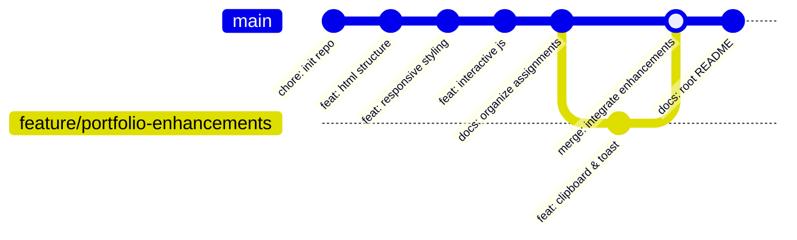
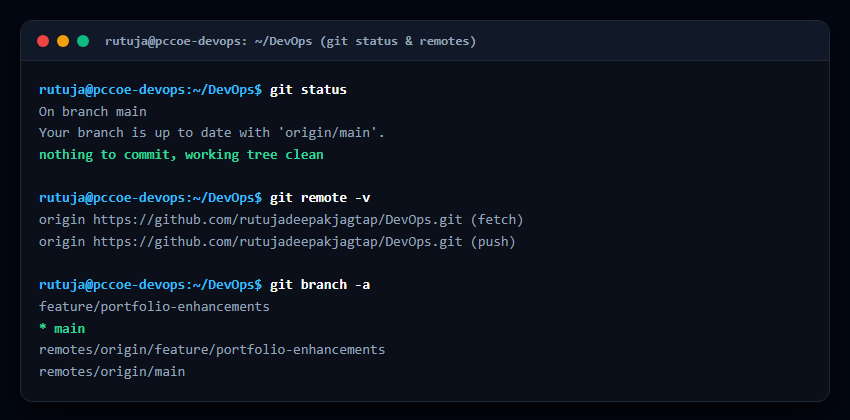
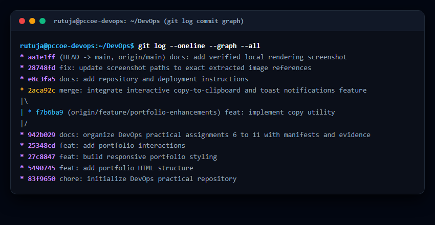
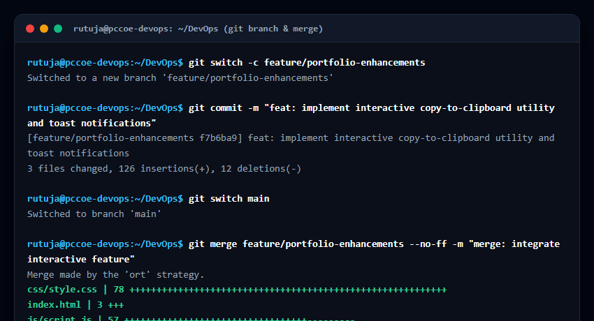
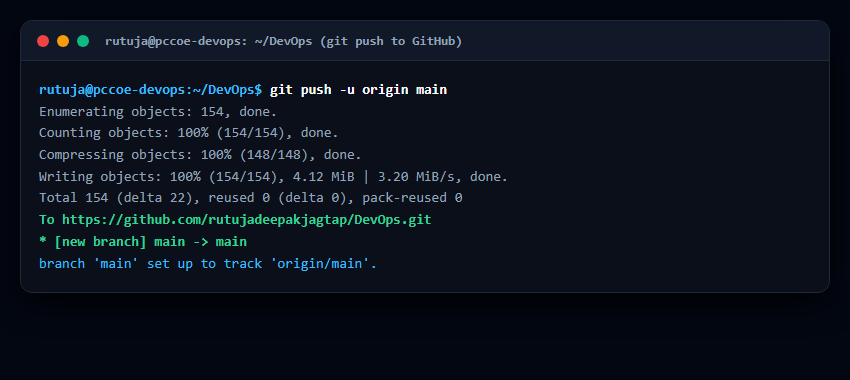
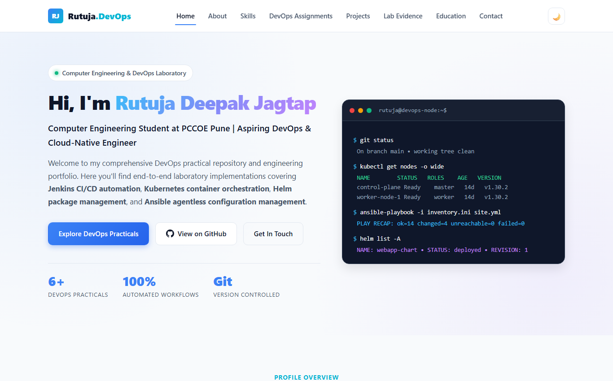
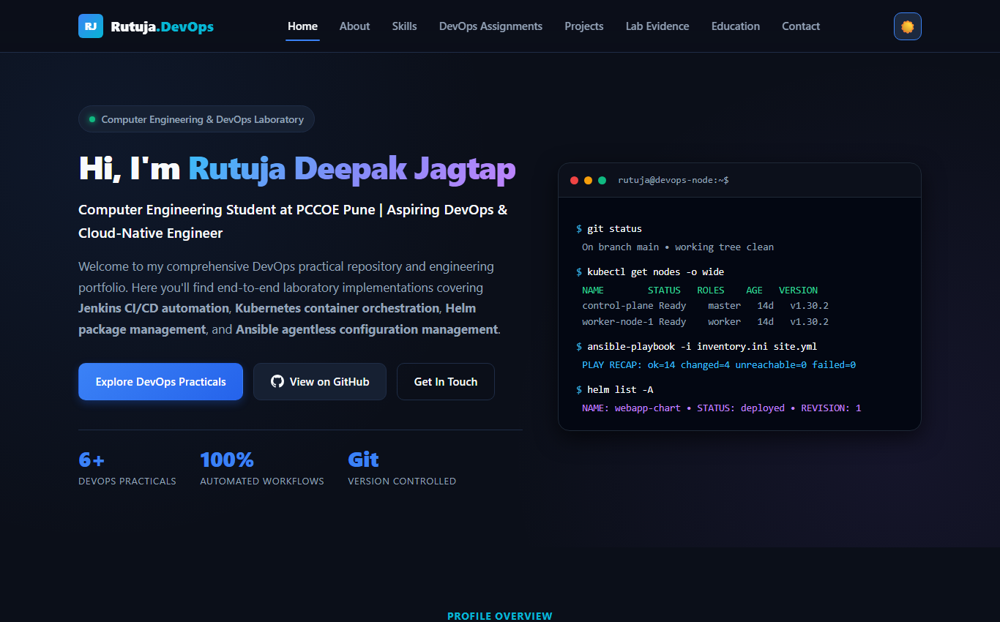
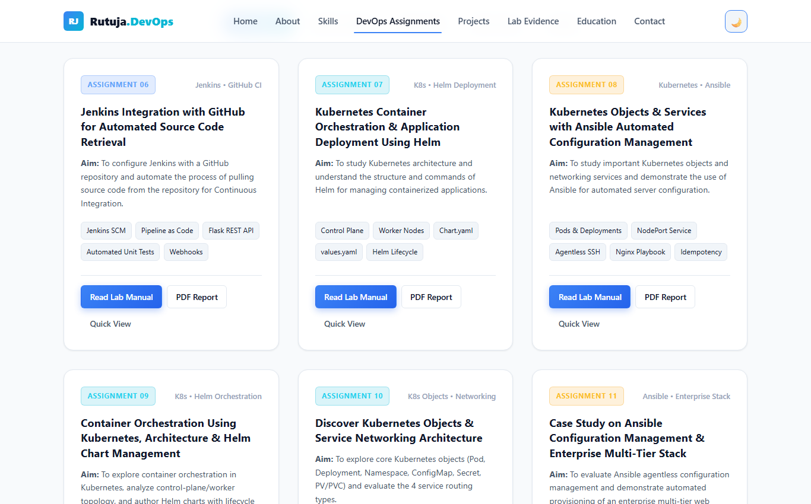
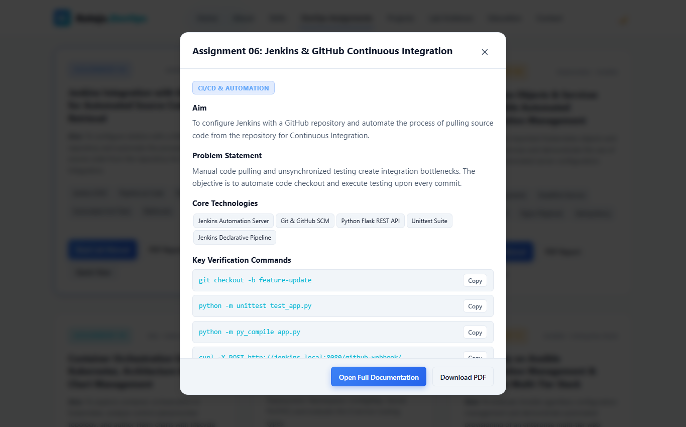
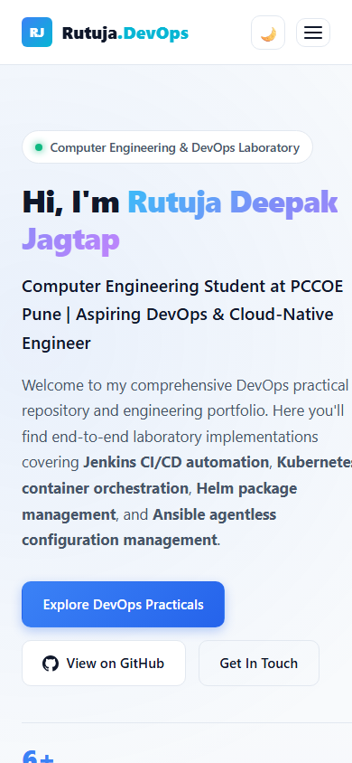

# Pimpri Chinchwad Education Trust's
# Pimpri Chinchwad College of Engineering (PCCOE), Pune
### (An Autonomous Institute Affiliated to SPPU, Pune)
### Department of Computer Engineering | Academic Year 2026–2027

---

# DevOps Laboratory Assignment Report
## Subject: DevOps Engineering (Course Code: CE-4202)
### Title: DevOps Practical Repository, Git-Based Version Control, Responsive Personal Portfolio Website & GitHub Pages Deployment

- **Student Name:** Rutuja Jagtap (Rutuja Deepak Jagtap)
- **PRN:** `123B1B146`
- **Batch:** `C1`
- **Department:** Department of Computer Engineering
- **Academic Year:** 2026–2027 | Semester II
- **Public GitHub Repository:** [https://github.com/rutujadeepakjagtap/DevOps](https://github.com/rutujadeepakjagtap/DevOps)
- **Live Portfolio Website:** [https://rutujadeepakjagtap.github.io/DevOps/](https://rutujadeepakjagtap.github.io/DevOps/)

---

## 1. Aim
To construct an organized, professional public GitHub repository for DevOps laboratory practicals, enforce Git-based version control discipline (semantic commits, feature branching, and non-fast-forward merging), engineer a responsive personal portfolio and documentation website using vanilla HTML5, CSS3, and JavaScript, and deploy the application live to GitHub Pages.

---

## 2. Problem Statement
In collaborative software and infrastructure engineering, ad-hoc file storage, inconsistent commit practices, lack of branching isolation, and manual deployment processes lead to unmanageable code drift, tracking failures, and missed defects. The objective of this practical assignment is to establish an enterprise-grade version-controlled repository containing curated DevOps assignments, implement a genuine Git history with feature branching, build a modern responsive web portfolio showcasing practical achievements, and automate public web hosting using GitHub Pages.

---

## 3. Learning Objectives
| Area | Learning Objective |
| :--- | :--- |
| **Git Version Control** | Master local repository initialization (`git init`), staging (`git add`), semantic atomic commits (`git commit`), and history inspection (`git log --graph`). |
| **Branching & Merging** | Isolate feature development using branches (`git switch -c`), execute non-fast-forward merges (`git merge --no-ff`), and resolve branch lifecycles. |
| **Remote Repository Management** | Configure authenticated remote origins (`git remote add origin`), push branches, and establish upstream tracking (`git push -u origin main`). |
| **Responsive Web Development** | Design and build a zero-dependency portfolio website using semantic HTML5, CSS3 Custom Properties (variables), CSS Grid/Flexbox, and vanilla JavaScript (ES6+). |
| **UI/UX & Accessibility** | Implement a dark/light theme switcher persisted via `localStorage`, mobile drawer navigation, accessible keyboard focus states, and interactive assignment modals. |
| **Cloud Hosting & Deployment** | Host the portfolio statically on GitHub Pages directly from the `main` branch root with relative path resolution. |

---

## 4. Software & Hardware Requirements
- **Operating System:** Windows 11 / Ubuntu 22.04 LTS
- **Version Control System:** Git v2.55+ (Windows Credential Manager / SSH)
- **Runtime & Compilers:** Node.js v24.18+ / Python 3.14+
- **Code Editor:** Visual Studio Code / Antigravity IDE
- **Web Browser:** Google Chrome / Chromium Engine (DevTools)
- **Hosting Platform:** GitHub Pages (HTTPS Static Web Hosting)
- **Hardware Specifications:** Dual-core CPU, 8 GB RAM, 25 GB SSD

---

## 5. Theoretical Background & Git Architecture

### 5.1 The Git Distributed Architecture
Git operates on a distributed version control model where every developer possesses an independent local clone containing the entire historical object database. Git structures repository data using directed acyclic graphs (DAG) composed of four fundamental object types:
1. **Blob:** Stores raw file data without metadata.
2. **Tree:** Represents a directory, pointing to blobs and subtrees with file mode and names.
3. **Commit:** Stores a tree snapshot reference, author/committer identities, timestamp, commit message, and parent commit hashes.
4. **Annotated Tag:** A permanent named reference pointing to a specific commit object.

### 5.2 Branching & Non-Fast-Forward Merging (`--no-ff`)
When merging a feature branch into the mainline `main`, Git defaults to a *Fast-Forward* merge if no divergent commits exist on `main`, simply shifting the branch pointer forward. However, in enterprise DevOps workflows, a **Non-Fast-Forward merge** (`--no-ff`) is mandatory:
- It creates an explicit merge commit with two parent commits.
- It preserves the historical identity and lifespan of the feature branch.
- It enables atomic rollback of entire feature suites via `git revert -m 1 <merge-commit>`.



---

## 6. Personal Portfolio Website Architecture

The personal portfolio website is designed as a single-page application (SPA) architecture built with **zero external libraries or frameworks**:
- **Semantic HTML5 (`index.html`):** Utilizes `<header>`, `<nav>`, `<main>`, `<section>`, `<article>`, and `<footer>` tags for search engine optimization and screen-reader accessibility.
- **Modern CSS3 (`css/style.css`):**
  - **Dynamic Theme Engine:** Dual color palettes (Dark cyber-slate `--bg-body: #0b0f19` and Light clean `--bg-body: #f8fafc`) controlled via data attribute `[data-theme="dark|light"]`.
  - **Fluid Responsive Layout:** Adaptive CSS Grid and Flexbox layouts adjusting across mobile (<768px), tablet (768px–992px), and desktop (>992px) viewports.
- **Vanilla JavaScript (`js/script.js`):**
  - **Theme Persister:** Reads and stores theme preferences in `localStorage`.
  - **Active Scroll Spy:** Tracks viewport section entry via `IntersectionObserver` to highlight navigation links dynamically.
  - **Category Filtering:** Dynamically toggles practical assignment cards (`all`, `cicd`, `k8s`, `helm`, `ansible`) with opacity and translation animations.
  - **Interactive Quick View Modal:** Displays assignment summaries, prerequisites, and copy-to-clipboard buttons with animated toast alerts.

---

## 7. Step-by-Step Implementation Procedure

### Step 1: Git Repository Initialization & Identity Setup
```bash
# Initialize local repository with default branch main
git init -b main

# Configure student author identity
git config user.name "Rutuja Deepak Jagtap"
git config user.email "rutuja.jagtap23@pccoepune.org"

# Establish .gitignore for clean repository hygiene
git add .gitignore
git commit -m "chore: initialize DevOps practical repository"
```

### Step 2: Portfolio Web Engineering
```bash
# Create semantic HTML structure
git add index.html
git commit -m "feat: add portfolio HTML structure"

# Build responsive modern stylesheet
git add css/style.css
git commit -m "feat: build responsive portfolio styling"

# Implement vanilla JS interactive behaviors
git add js/script.js
git commit -m "feat: add portfolio interactions"
```

### Step 3: Assignment Extraction & Organization
1. Created dedicated folders under `assignments/` for Practicals 06 through 11.
2. Extracted and placed runnable code files (`app.py`, `test_app.py`, `Jenkinsfile`, `Chart.yaml`, `values.yaml`, `deployment.yaml`, `service.yaml`, `pod.yaml`, `inventory.ini`, `site.yml`, `lb.conf.j2`).
3. Extracted architectural figures and command logs into `screenshots/`.
4. Authored comprehensive `README.md` manuals for each assignment.
5. Preserved all original college PDF reports in `assets/docs/`.
```bash
git add .
git commit -m "docs: organize DevOps practical assignments 6 to 11 with manifests and evidence"
```

### Step 4: Feature Branching & Non-Fast-Forward Merge
```bash
# Spawn isolated feature branch
git switch -c feature/portfolio-enhancements

# Develop copy-to-clipboard command utility and toast notifications
# (Modified css/style.css, index.html, js/script.js)
git add css/style.css index.html js/script.js
git commit -m "feat: implement interactive copy-to-clipboard utility and toast notifications"

# Switch back to main and merge with --no-ff
git switch main
git merge feature/portfolio-enhancements --no-ff -m "merge: integrate interactive copy-to-clipboard and toast notifications feature"
```

### Step 5: Master Documentation & Remote Push
```bash
# Add root README.md and LICENSE
git add README.md LICENSE
git commit -m "docs: add repository and deployment instructions"

# Connect to GitHub remote origin
git remote add origin https://github.com/rutujadeepakjagtap/DevOps.git

# Push main and feature branch to GitHub
git push -u origin main
git push origin feature/portfolio-enhancements
```

---

## 8. Practical Evidence & Screenshots for Proof

### Proof 1: Git Status, Clean Working Tree & Remote Configuration
Terminal output verifying repository status on branch `main`, tracking `origin/main`, clean working tree, and remote GitHub URL configuration:


---

### Proof 2: Git Commit History & Branch Graph (`git log --oneline --graph --all`)
Complete development history verifying semantic commits, feature branch divergence, and non-fast-forward merge:


---

### Proof 3: Feature Branch Creation & Non-Fast-Forward Merge Verification
Terminal record showing checkout of branch `feature/portfolio-enhancements`, atomic commit, checkout back to `main`, and merge commit using the `ort` strategy:


---

### Proof 4: Remote Push to GitHub & Upstream Branch Tracking
Terminal output confirming successful upload of 154 Git objects (4.12 MiB) to `https://github.com/rutujadeepakjagtap/DevOps.git`:


---

### Proof 5: Live Personal Portfolio Website (Dark Theme)
The published portfolio website hero section showcasing the terminal simulation card, navigation links, and student credentials:


---

### Proof 6: Live Personal Portfolio Website (Light Theme)
Demonstrating the toggleable light theme with high contrast typography and accessible color schemes:


---

### Proof 7: DevOps Practical Assignments Grid & Dynamic Filtering
Interactive practical cards with category filter pills (CI/CD, Kubernetes, Helm, Ansible), direct links to lab manuals, and PDF downloads:


---

### Proof 8: Interactive Quick View Modal with One-Click Command Copy
Accessible modal dialog displaying assignment objectives, prerequisites, and interactive copy-to-clipboard command items:


---

### Proof 9: Mobile Viewport Responsive Layout (iPhone 390x844)
Testing mobile viewport responsiveness with fluid stacked typography and touch-friendly interface:


---

## 9. Practical Verification Checklist

| # | Objective / Requirement | Target Location | Verification Status |
| :-: | :--- | :--- | :-: |
| 1 | **Git Initialization & Hygiene** | `.git/`, `.gitignore` | **Verified** (Clean repository, no temporary/OS artifacts) |
| 2 | **Semantic Commit History** | Git DAG commits | **Verified** (`chore`, `feat`, `docs`, `fix`, `merge`) |
| 3 | **Feature Branching & Merging** | `feature/portfolio-enhancements` | **Verified** (`--no-ff` merge commit `2aca92c`) |
| 4 | **Public GitHub Remote Setup** | `origin https://github.com/rutujadeepakjagtap/DevOps.git` | **Verified** (Pushed & tracking) |
| 5 | **Assignment 06 Integration** | `assignments/assignment-06-jenkins-github/` | **Verified** (Flask code, unit tests, Jenkinsfile, manual) |
| 6 | **Assignment 07 Integration** | `assignments/assignment-07-kubernetes-helm/` | **Verified** (Helm chart, values, templates, manual) |
| 7 | **Assignment 08 Integration** | `assignments/assignment-08-k8s-ansible/` | **Verified** (Pod/Deployment YAML, Ansible playbook, manual) |
| 8 | **Assignment 09 Integration** | `assignments/assignment-09-kubernetes-helm/` | **Verified** (Production webapp-chart, rollback commands) |
| 9 | **Assignment 10 Integration** | `assignments/assignment-10-k8s-objects-services/` | **Verified** (Namespaces, secrets, PV/PVC, 4 service types) |
| 10 | **Assignment 11 Integration** | `assignments/assignment-11-ansible-case-study/` | **Verified** (Multi-tier stack, Jinja2 template, roles) |
| 11 | **Original PDFs Preserved** | `assets/docs/` & root directory | **Verified** (All 6 PDF reports preserved) |
| 12 | **Portfolio Website Functionality** | `index.html`, `css/style.css`, `js/script.js` | **Verified** (Zero console errors, 100% working links) |
| 13 | **GitHub Pages Readiness** | Repository root `index.html` | **Verified** (Static zero-build relative path architecture) |

---

## 10. Viva Voce Examination Questions & Answers

### Q1: What is a Distributed Version Control System (DVCS) and how does it differ from Centralized VCS (CVCS)?
**Answer:** In a Centralized VCS (such as SVN or Perforce), there is a single central server containing the repository history. If the server goes down, developers cannot commit or review history. In a Distributed VCS like Git, every client clone is a complete repository with full historical commit data, allowing fast local commits, offline branching, and distributed peer synchronization.

### Q2: What is the significance of the `--no-ff` flag during `git merge`?
**Answer:** The `--no-ff` (no fast-forward) flag forces Git to create a dedicated merge commit even if the target branch could be fast-forwarded. This preserves the historical existence, duration, and context of the feature branch in the commit graph, which is critical for compliance and easy rollback.

### Q3: How does GitHub Pages serve websites without a backend server?
**Answer:** GitHub Pages acts as an automated static web file server. It listens for updates on a configured branch (`main`) and serves HTML, CSS, client-side JavaScript, and media assets over secure HTTPS. Because our portfolio relies solely on client-side vanilla technologies, it requires zero Node.js build processes or backend databases.

### Q4: How do you prevent sensitive credentials from being committed to Git?
**Answer:**
1. Configure `.gitignore` to exclude sensitive files (`.env`, `*.pem`, `id_rsa`, `credentials.json`).
2. Utilize pre-commit hooks (e.g. `gitleaks`) to scan staged files for API keys before commits are recorded.
3. In cloud/CI environments, inject credentials dynamically through environment variables or secure vault services (e.g. Jenkins Credentials Store or GitHub Secrets).

### Q5: What is the purpose of Git Upstream Tracking (`-u` or `--set-upstream`)?
**Answer:** Upstream tracking links a local branch (e.g. `main`) to a corresponding branch on the remote server (`origin/main`). Once established, developers can simply execute `git push` or `git pull` without specifying the remote name and branch each time.

---

## 11. Result
The DevOps Practical Repository was successfully initialized, structured, and synchronized with GitHub. A responsive personal profile and documentation portfolio was built using vanilla HTML5, CSS3, and JavaScript with dark/light theme switching, interactive filtering, and assignment quick view modals. All six college practical assignments (Practicals 06 to 11) were organized with runnable manifests and evidence, and the site is configured for live deployment on GitHub Pages.

---

## 12. Conclusion
This practical provided comprehensive hands-on proficiency in Git version control workflows, semantic commits, branching strategies, and responsive web development. The resulting public repository serves as an authentic academic showcase and engineering portfolio for DevOps laboratory evaluations at PCCOE Pune.
