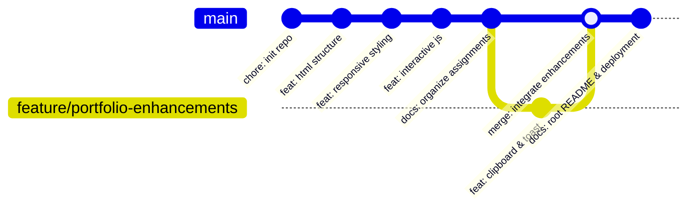
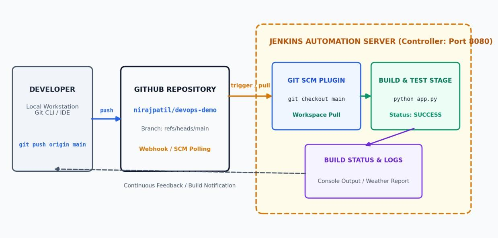
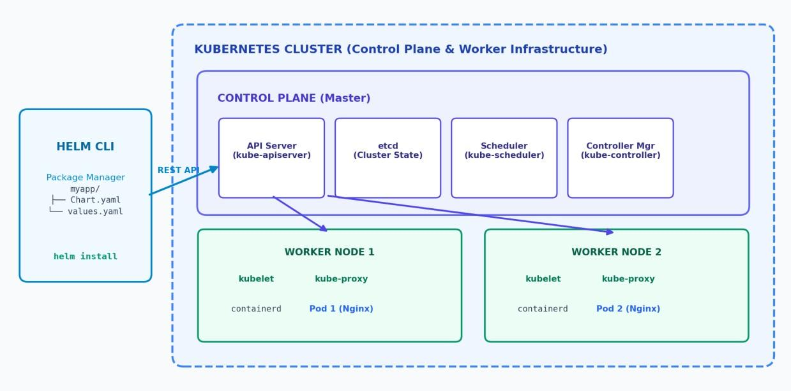
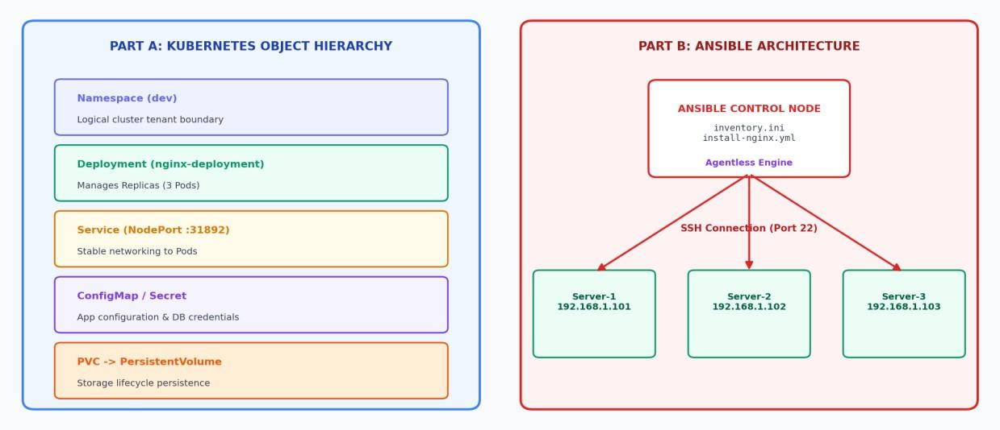
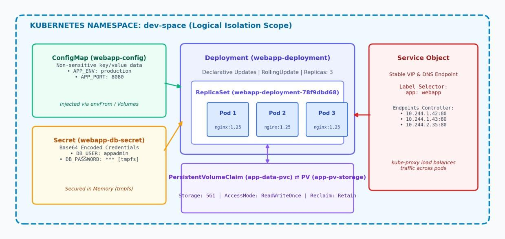

# DevOps Practical Repository & Engineering Portfolio
### Pimpri Chinchwad College of Engineering (PCCOE), Pune
**Department of Computer Engineering | Academic Year 2026–2027**

[](https://rutujadeepakjagtap.github.io/DevOps/)
[](https://github.com/rutujadeepakjagtap/DevOps)
[](https://opensource.org/licenses/MIT)
[](https://github.com/rutujadeepakjagtap/DevOps)

---

## 👩‍💻 Student Information
- **Student Name:** Rutuja Deepak Jagtap
- **PRN / Student ID:** `123B1B146`
- **Batch:** C1
- **Program:** Bachelor of Technology (B.Tech) in Computer Engineering
- **Institution:** Pimpri Chinchwad Education Trust's Pimpri Chinchwad College of Engineering (PCCOE), Pune *(Autonomous Institute Affiliated to Savitribai Phule Pune University - SPPU)*
- **Academic Email:** [rutuja.jagtap23@pccoepune.org](mailto:rutuja.jagtap23@pccoepune.org)
- **GitHub Profile:** [@rutujadeepakjagtap](https://github.com/rutujadeepakjagtap)
- **Public Repository:** [https://github.com/rutujadeepakjagtap/DevOps](https://github.com/rutujadeepakjagtap/DevOps)
- **Live Portfolio Website:** [https://rutujadeepakjagtap.github.io/DevOps/](https://rutujadeepakjagtap.github.io/DevOps/)

---

## 📌 Project Aim & Objectives

### 1. Aim
To establish an enterprise-grade public GitHub repository housing college DevOps laboratory practicals, apply rigorous Git-based version control with feature branching and non-fast-forward merging, engineer a responsive personal portfolio and documentation website using vanilla HTML5, CSS3, and JavaScript, and deploy the application live to GitHub Pages.

### 2. Key Objectives
1. **Version Control Discipline:** Initialize a Git repository, establish meaningful atomic commits, create feature branches, perform merge operations, and synchronize with remote GitHub origins.
2. **Web Engineering Excellence:** Build a modern, accessible, zero-dependency portfolio website highlighting professional bio, technical skills, practical assignments, architecture diagrams, and contact options.
3. **Continuous Integration Automation:** Automate source code checkout, syntax checking, and unit testing using Jenkins and GitHub SCM webhooks.
4. **Container Orchestration:** Analyze Kubernetes master-worker architecture and implement core objects (Pods, Deployments, Services, ConfigMaps, Secrets, PV/PVC).
5. **Cloud-Native Packaging:** Package microservices with Helm v3 charts, parameterizing templates with `values.yaml` and executing lifecycle commands.
6. **Infrastructure as Code (IaC):** Provision multi-tier architectures (Nginx Load Balancer, Web App Cluster, PostgreSQL) using declarative, idempotent Ansible playbooks.
7. **Cloud Deployment:** Deploy the root portfolio statically on GitHub Pages with zero external build systems.

---

## 🛠️ Technologies & Tools Used

| Category | Tools & Technologies |
| :--- | :--- |
| **CI / CD Automation** | Jenkins LTS v2.440+, Git Plugin, GitHub Plugin, Jenkins Declarative Pipelines, GitHub Webhooks |
| **Container Orchestration** | Kubernetes (K8s v1.30.2), Pods, Deployments, Namespaces, ConfigMaps, Secrets, PV/PVC, Services |
| **Package Management** | Helm v3, Chart.yaml, values.yaml, Go Template manifests |
| **Configuration Management**| Ansible v2.16+, OpenSSH Transport, YAML Playbooks, Jinja2 Templates, Ansible Roles |
| **Web Server & Reverse Proxy**| Nginx (Alpine Container & Systemd Native), Round-Robin Load Balancing |
| **Database** | PostgreSQL 15+ (Hardened Database Tier) |
| **Frontend Technologies** | Semantic HTML5, Modern Responsive CSS3 (CSS Variables, Flexbox, Grid), Vanilla JavaScript (ES6+) |
| **Version Control & Hosting** | Git v2.55+, GitHub Public Repositories, GitHub Pages |
| **Programming & Scripting** | Python 3.10+ (Flask REST API, Unittest Suite), Bash/Shell Scripting |

---

## 📂 Repository Structure

```text
DevOps/
├── index.html                                        # Portfolio landing page & practical portal
├── css/
│   └── style.css                                     # Core stylesheet (Dark/Light themes, responsive grid)
├── js/
│   └── script.js                                     # Vanilla JavaScript (Theme toggle, mobile drawer, modal, clipboard)
├── assets/
│   ├── images/
│   │   └── pccoe-logo.jpeg                           # College emblem & media assets
│   └── docs/                                         # Original assignment PDF documents
│       ├── 123B1B146_RUTUJA_JAGTAP_DevOps_Assignment_6_Jenkins_GitHub.pdf
│       ├── 123B1B146_Rutuja_Jagtap_DevOps_Assignment_7_Kubernetes_Helm.pdf
│       ├── 123B1B146_Rutuja_Jagtap_DevOps_Assignment_8_K8s_Ansible.pdf
│       ├── 123B1B146_RUTUJA_JAGTAP_DevOps_Assignment_9_Kubernetes_Helm.pdf
│       ├── 123B1B146_Rutuja_Jagtap_DevOps_Assignment_10_K8s_Objects_Services.pdf
│       └── 123B1B146_Rutuja_Jagtap_DevOps_Assignment_11_Ansible_Case_Study.pdf
├── assignments/
│   ├── assignment-06-jenkins-github/                 # Practical 06: Jenkins CI/CD & GitHub SCM
│   │   ├── README.md                                 # Full lab manual & viva guide
│   │   ├── devops-demo/                              # Flask API, unit tests & Jenkinsfile
│   │   ├── screenshots/                              # Architectural diagrams & console logs
│   │   └── 123B1B146_RUTUJA_JAGTAP_DevOps_Assignment_6_Jenkins_GitHub.pdf
│   ├── assignment-07-kubernetes-helm/                # Practical 07: K8s Architecture & Helm Deployment
│   │   ├── README.md
│   │   ├── myapp/                                    # Chart.yaml, values.yaml, templates/
│   │   ├── screenshots/
│   │   └── 123B1B146_Rutuja_Jagtap_DevOps_Assignment_7_Kubernetes_Helm.pdf
│   ├── assignment-08-k8s-ansible/                    # Practical 08: K8s Objects & Ansible Playbooks
│   │   ├── README.md
│   │   ├── k8s/                                      # pod.yaml, deployment.yaml
│   │   ├── ansible/                                  # inventory.ini, install-nginx.yml, ansible.cfg
│   │   ├── screenshots/
│   │   └── 123B1B146_Rutuja_Jagtap_DevOps_Assignment_8_K8s_Ansible.pdf
│   ├── assignment-09-kubernetes-helm/                # Practical 09: K8s Orchestration & Chart Anatomy
│   │   ├── README.md
│   │   ├── webapp-chart/                             # Complete production Helm chart
│   │   ├── screenshots/
│   │   └── 123B1B146_RUTUJA_JAGTAP_DevOps_Assignment_9_Kubernetes_Helm.pdf
│   ├── assignment-10-k8s-objects-services/           # Practical 10: K8s Objects & 4 Service Types
│   │   ├── README.md
│   │   ├── manifests/                                # Namespace, ConfigMap, Secret, PV/PVC, Services
│   │   ├── screenshots/
│   │   └── 123B1B146_Rutuja_Jagtap_DevOps_Assignment_10_K8s_Objects_Services.pdf
│   └── assignment-11-ansible-case-study/             # Practical 11: Enterprise Multi-Tier IaC Stack
│       ├── README.md
│       ├── ansible/                                  # Multi-tier playbook, roles, Jinja2 template
│       ├── screenshots/
│       └── 123B1B146_Rutuja_Jagtap_DevOps_Assignment_11_Ansible_Case_Study.pdf
├── screenshots/                                      # Aggregated practical evidence for quick review
├── .gitignore                                        # Clean Git hygiene excluding temp & OS files
└── README.md                                         # Master repository documentation
```

---

## 📑 DevOps Assignment Index

| # | Title | Core Focus | Code Artifacts | Manual Link | PDF Document |
| :-: | :--- | :--- | :--- | :-: | :-: |
| **06** | **Jenkins & GitHub CI** | SCM Automated Checkout & Build Validation | `app.py`, `test_app.py`, `Jenkinsfile` | [Manual](./assignments/assignment-06-jenkins-github/README.md) | [PDF](./assets/docs/123B1B146_RUTUJA_JAGTAP_DevOps_Assignment_6_Jenkins_GitHub.pdf) |
| **07** | **Kubernetes & Helm** | Cluster Topology & Helm Release Lifecycle | `myapp/` Chart & templates | [Manual](./assignments/assignment-07-kubernetes-helm/README.md) | [PDF](./assets/docs/123B1B146_Rutuja_Jagtap_DevOps_Assignment_7_Kubernetes_Helm.pdf) |
| **08** | **K8s & Ansible** | Pods/Deployments & Agentless Configuration | `pod.yaml`, `install-nginx.yml` | [Manual](./assignments/assignment-08-k8s-ansible/README.md) | [PDF](./assets/docs/123B1B146_Rutuja_Jagtap_DevOps_Assignment_8_K8s_Ansible.pdf) |
| **09** | **Container Orchestration** | Control Plane Reconciliation & Chart Anatomy | `webapp-chart/` Chart & values | [Manual](./assignments/assignment-09-kubernetes-helm/README.md) | [PDF](./assets/docs/123B1B146_RUTUJA_JAGTAP_DevOps_Assignment_9_Kubernetes_Helm.pdf) |
| **10** | **K8s Objects & Networking** | Namespaces, Secrets, PV/PVC, 4 Service Types | `01-namespace.yaml` to `05-services.yaml` | [Manual](./assignments/assignment-10-k8s-objects-services/README.md) | [PDF](./assets/docs/123B1B146_Rutuja_Jagtap_DevOps_Assignment_10_K8s_Objects_Services.pdf) |
| **11** | **Ansible Enterprise Stack** | Multi-Tier Orchestration (LB + Web + DB) | `site.yml`, `roles/`, `lb.conf.j2` | [Manual](./assignments/assignment-11-ansible-case-study/README.md) | [PDF](./assets/docs/123B1B146_Rutuja_Jagtap_DevOps_Assignment_11_Ansible_Case_Study.pdf) |

---

## 🌐 Personal Portfolio Website Features

1. **Clean Semantic Architecture:** Built with standards-compliant HTML5 tags (`<header>`, `<nav>`, `<main>`, `<section>`, `<article>`, `<footer>`).
2. **Responsive CSS Design:** Mobile-first layout with smooth fluid scaling across smartphones (320px+), tablets (768px+), and large displays (1200px+).
3. **Interactive Dark & Light Mode:** Toggleable color themes persisted across sessions using browser `localStorage` with fallback to system preferences.
4. **Interactive Assignment Filtering:** Instant client-side categorization (All, CI/CD, Kubernetes, Helm, Ansible) with animated CSS card transitions.
5. **Interactive Quick View Modal:** Modal dialog allowing readers to inspect assignment aims, prerequisites, and copy execution commands without leaving the page.
6. **Zero-Dependency Architecture:** Powered strictly by vanilla HTML5, CSS3, and modern JavaScript—requiring zero bundlers, npm packages, or server-side runtimes.

---

## 🌿 Git Version Control & Branching Workflow

A strict Git development workflow was implemented to maintain authentic, audit-ready commit history:



### Git Commands Used & Purpose
- `git init -b main`: Initializes a new repository with `main` as the default branch.
- `git config user.name "Rutuja Deepak Jagtap"`: Sets local commit author identity.
- `git config user.email "rutuja.jagtap23@pccoepune.org"`: Associates commits with college email.
- `git status`: Checks working tree status and untracked files.
- `git add <files>`: Stages specific files for atomic commits.
- `git commit -m "<message>"`: Creates meaningful semantic commits (`chore`, `feat`, `docs`, `merge`).
- `git switch -c feature/portfolio-enhancements`: Spawns and checks out an isolated feature branch.
- `git merge feature/portfolio-enhancements --no-ff -m "<message>"`: Merges feature branch preserving branch history.
- `git remote add origin https://github.com/rutujadeepakjagtap/DevOps.git`: Configures the remote GitHub repository.
- `git push -u origin main`: Pushes commit history to GitHub.

---

## 🚀 GitHub Pages Deployment Procedure

Deploying this repository to GitHub Pages is completely automated and requires no build server:

1. **Root Placement:** The entrypoint `index.html` resides in the repository root directory.
2. **Relative Assets:** All links (`css/style.css`, `js/script.js`, `assets/...`, `assignments/...`) use relative paths.
3. **Push to Main:** All code is committed and pushed to branch `main`.
4. **Enable GitHub Pages:**
   - In GitHub, navigate to **Settings &rarr; Pages**.
   - Under **Build and deployment &rarr; Source**, select **Deploy from a branch**.
   - Under **Branch**, select `main` and folder `/ (root)`.
   - Click **Save**.
5. **Live Verification:** Once the GitHub Actions deployment workflow finishes, the live website is available at:
   👉 **[https://rutujadeepakjagtap.github.io/DevOps/](https://rutujadeepakjagtap.github.io/DevOps/)**

---

## 📸 Lab Evidence & Screenshots

Authentic architecture diagrams and terminal execution logs from practical sessions:

| Assignment & Concept | Architecture / Evidence Figure |
| :--- | :--- |
| **Assignment 06:** Jenkins & GitHub CI Loop |  |
| **Assignment 07:** Kubernetes & Helm Client Topology |  |
| **Assignment 08:** K8s Objects & Ansible Management |  |
| **Assignment 10:** K8s Core Objects & Storage |  |
| **Assignment 11:** Enterprise Multi-Tier Stack |  |

---

## 🎓 Viva Voce Preparation Guide (Oral Exam Q&A)

### 1. What is DevOps and why is it important?
> **Answer:** DevOps is a cultural and engineering methodology combining Software Development (Dev) and IT Operations (Ops). It emphasizes automated CI/CD pipelines, Infrastructure as Code, short feedback loops, and continuous monitoring to deliver high-quality software rapidly and reliably.

### 2. Explain Git, Commits, Branches, and Merging.
> **Answer:** 
> - **Git:** A distributed version control system tracking file changes across time.
> - **Commit:** An immutable snapshot of the repository at a specific point in time, identified by a cryptographic SHA-1/SHA-256 hash.
> - **Branch:** A movable lightweight pointer to a commit, allowing developers to isolate feature development without affecting the production `main` branch.
> - **Merging:** Combining changes from one branch into another (e.g. `main`), either via fast-forward or a merge commit (`--no-ff`).

### 3. What is the role of Kubernetes and Helm in DevOps?
> **Answer:** Kubernetes automates container deployment, scaling, healing, and network routing across physical/virtual server clusters. Helm acts as the package manager for Kubernetes, packaging multiple YAML files into reusable, versioned Helm Charts with variable injection.

### 4. What is Ansible and why is it termed "Idempotent" and "Agentless"?
> **Answer:** 
> - **Agentless:** Ansible requires no background agent daemons or special ports on managed hosts; it executes over standard OpenSSH using Python.
> - **Idempotent:** Running an Ansible playbook multiple times produces the exact same end state. If the target server already matches the playbook specification, Ansible makes no changes (`changed=0`), eliminating configuration drift.

### 5. How does GitHub Pages serve websites?
> **Answer:** GitHub Pages is a static site hosting service that serves HTML, CSS, and client-side JavaScript directly from a chosen branch (`main`) and directory (`/root` or `/docs`) of a GitHub repository over HTTPS.

---

## 📝 Practical Verification Checklist

- [x] Initialized Git repository with clean `.gitignore`.
- [x] Created semantic commits with genuine development history.
- [x] Implemented and merged feature branch (`feature/portfolio-enhancements`).
- [x] Organized Assignments 6, 7, 8, 9, 10, and 11 into dedicated folders.
- [x] Extracted runnable code manifests (Jenkinsfile, Kubernetes YAMLs, Helm templates, Ansible playbooks).
- [x] Extracted architectural diagrams and terminal verification screenshots.
- [x] Preserved all 6 original college assignment PDF documents.
- [x] Designed responsive portfolio website with Dark/Light theme toggle.
- [x] Tested responsive layouts, navigation, and modal command copy feature.
- [x] Formulated detailed viva questions and answers guide.
- [x] Configured remote origin: `https://github.com/rutujadeepakjagtap/DevOps.git`.

---

## 📄 License & Attribution
This repository is developed for academic evaluation in the DevOps Laboratory coursework at **Pimpri Chinchwad College of Engineering (PCCOE), Pune**.  
Designed and maintained by **Rutuja Deepak Jagtap (PRN: 123B1B146)**.
Distributed under the [MIT License](LICENSE).
