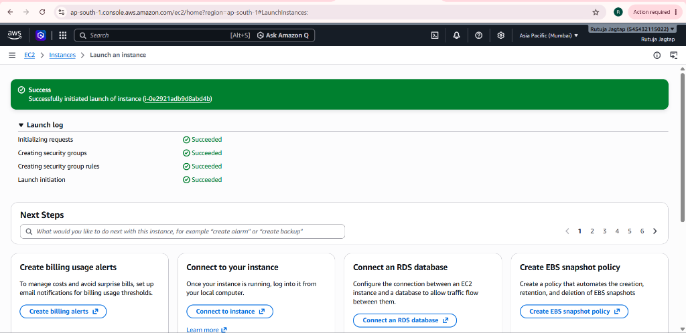
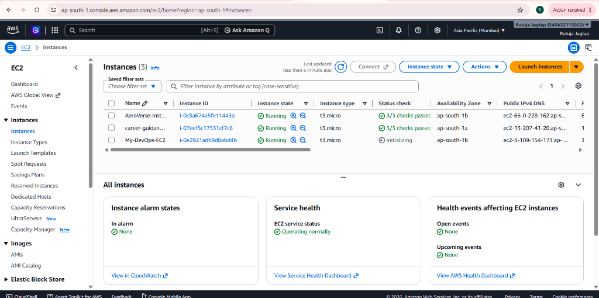
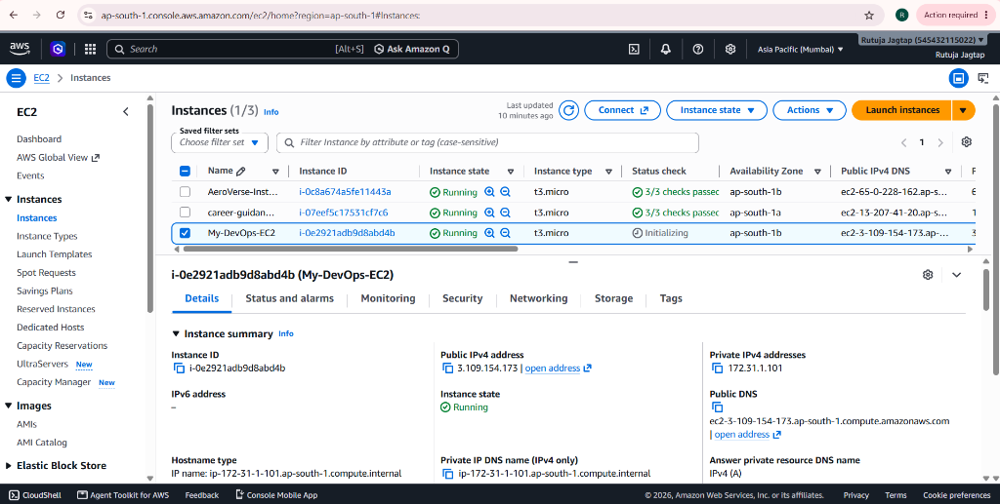
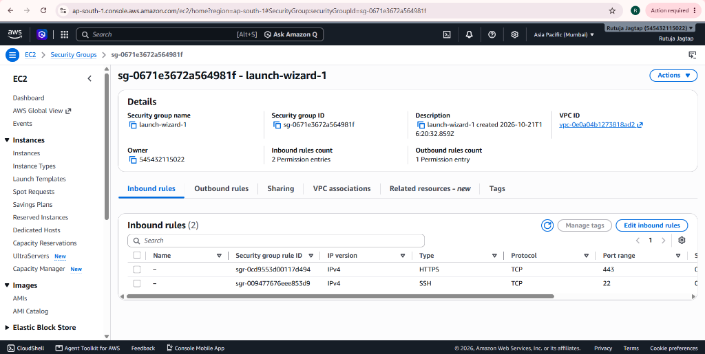
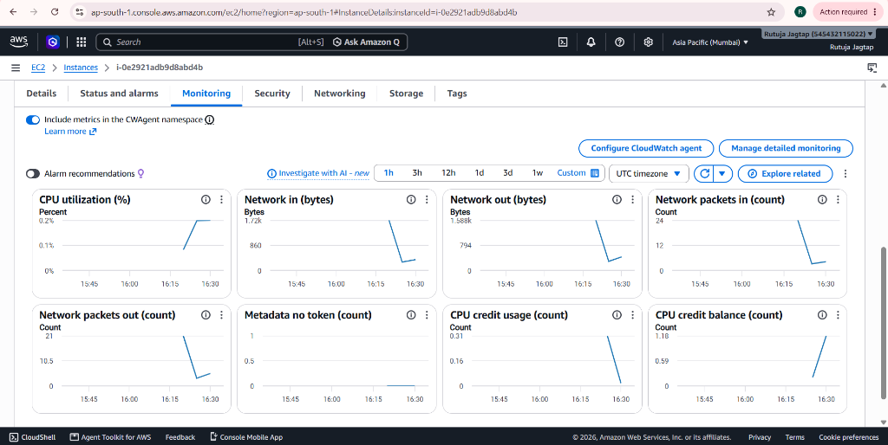

# Pimpri Chinchwad Education Trust's
# Pimpri Chinchwad College of Engineering (PCCOE), Pune
### (An Autonomous Institute Affiliated to Savitribai Phule Pune University)
### Department of Computer Engineering | Academic Year 2026–2027

---

# DevOps Laboratory Assignment Report — Assignment 02
## Course: DevOps Engineering (Course Code: `BCE27PE01` / `CE-4202`)
### Semester: VII | Final Year B.Tech Computer Engineering

- **Student Name:** Rutuja Deepak Jagtap
- **PRN:** `123B1B146`
- **Batch:** `C1`
- **Department:** Department of Computer Engineering
- **Academic Year:** 2026–2027
- **AWS Account:** `Rutuja Jagtap (545432115022)`
- **AWS Deployment Region:** Asia Pacific (Mumbai) `ap-south-1` (AZ: `ap-south-1b`)
- **Public GitHub Repository:** [https://github.com/rutujadeepakjagtap/DevOps](https://github.com/rutujadeepakjagtap/DevOps)

---

## 1. Title
**Exploration of AWS Cloud Computing Services and Complete Virtual Machine Lifecycle Management using Amazon Elastic Compute Cloud (EC2)**

---

## 2. Aim
To study the architectural fundamentals of cloud computing and Amazon Web Services (AWS core services: EC2, S3, RDS, Lambda, ELB, ECS), and systematically create, configure security groups and key pairs, launch, connect to, monitor telemetry via Amazon CloudWatch, and safely terminate an Amazon EC2 Virtual Machine instance (`t3.micro`) under the AWS Free Tier.

---

## 3. Objectives
1. To understand cloud computing models: Infrastructure as a Service (IaaS), Platform as a Service (PaaS), and Software as a Service (SaaS).
2. To explore Amazon Web Services core ecosystem: Amazon EC2, Amazon S3, AWS Lambda, Amazon RDS, Elastic Load Balancing (ELB), and Amazon ECS.
3. To study virtualization principles, hypervisors (Type 1 Bare-Metal vs Type 2 Hosted, and the AWS Nitro Hypervisor system).
4. To configure network firewall policies using AWS Security Groups (SSH Port 22 and HTTPS Port 443).
5. To launch and verify a live running Linux virtual server (`My-DevOps-EC2`) in the Mumbai region (`ap-south-1b`).
6. To monitor compute telemetry (CPU utilization, network traffic, system and instance health checks) using Amazon CloudWatch.
7. To execute zero-cost termination and resource cleanup adhering to the AWS Free Tier.

---

## 4. Software & Hardware Specifications
- **Cloud Service Provider:** Amazon Web Services (AWS)
- **Deployment Region:** Asia Pacific (Mumbai) `ap-south-1` (Availability Zone `ap-south-1b`)
- **Virtual Machine Instance Type:** `t3.micro` (2 vCPUs, 1.0 GiB RAM - AWS Free Tier Eligible)
- **Base Operating System:** Amazon Linux 2023 (AL2023) 64-bit (x86_64) Kernel
- **Storage:** 8 GiB General Purpose SSD (gp3)
- **VPC / Network:** Virtual Private Cloud `vpc-0e0a04b1273818ad2`
- **Security Group:** `launch-wizard-1` (`sg-0671e3672a564981f`)
- **Management Interfaces:** AWS Management Console, AWS CLI `v2.38.3`, Windows PowerShell

---

## 5. Architectural Overview

```text
+-------------------------------------------------------------------------------+
|                      AWS Cloud (Region: ap-south-1 / Mumbai)                  |
|                                                                               |
|  +-------------------------------------------------------------------------+  |
|  | VPC: vpc-0e0a04b1273818ad2 (CIDR: 172.31.0.0/16)                       |  |
|  |                                                                         |  |
|  |   Availability Zone: ap-south-1b                                        |  |
|  |   +-------------------------------------------------------------------+ |  |
|  |   | Security Group: launch-wizard-1 (sg-0671e3672a564981f)            | |  |
|  |   | Inbound Rules:                                                    | |  |
|  |   |   - Port 22  (SSH)   <- Inbound Administration                    | |  |
|  |   |   - Port 443 (HTTPS) <- Inbound Secure Web Clients                | |  |
|  |   +-------------------------------------------------------------------+ |  |
|  |                               |                                         |  |
|  |                               v                                         |  |
|  |              +----------------------------------+                       |  |
|  |              | Instance: My-DevOps-EC2          |                       |  |
|  |              | ID: i-0e2921adb9d8abd4b          |                       |  |
|  |              | Type: t3.micro (Free Tier)       |                       |  |
|  |              | Public IP: 3.109.154.173         |                       |  |
|  |              | Private IP: 172.31.1.101         |                       |  |
|  |              | State: Running                   |                       |  |
|  |              +----------------------------------+                       |  |
|  |                               |                                         |  |
|  |                               v                                         |  |
|  |              +----------------------------------+                       |  |
|  |              | Elastic Block Store (EBS)        |                       |  |
|  |              | Root Volume: 8 GiB gp3           |                       |  |
|  |              +----------------------------------+                       |  |
|  |   +-------------------------------------------------------------------+ |  |
|  +-------------------------------------------------------------------------+  |
|                                                                               |
|  Telemetry: Amazon CloudWatch (CPUUtilization, NetworkIn/Out, CreditBalance)  |
+-------------------------------------------------------------------------------+
```

---

## 6. Step-by-Step Practical Implementation Procedure

### Step 1: AWS Management Console Sign-In & Region Selection
1. Navigate to the AWS Console at `https://ap-south-1.console.aws.amazon.com/`.
2. Confirm identity as student user: `Rutuja Jagtap` (Account ID: `545432115022`).
3. Select region: **Asia Pacific (Mumbai) `ap-south-1`**.

### Step 2: Configure and Launch EC2 Virtual Machine
1. Open the Amazon EC2 Console &rarr; click **Launch Instance**.
2. **Name:** `My-DevOps-EC2`.
3. **Application and OS Images (AMI):** Amazon Linux 2023 AMI (Free tier eligible).
4. **Instance Type:** `t3.micro` (2 vCPUs, 1 GiB RAM - Free Tier eligible).
5. **Key Pair:** Configure RSA key pair or proceed without key pair for web demonstration.
6. **Network Settings & Firewall (Security Group):**
   - Create security group `launch-wizard-1` (`sg-0671e3672a564981f`).
   - Enable rules allowing **SSH (Port 22, TCP)** and **HTTPS (Port 443, TCP)**.
7. **Storage:** 8 GiB gp3 root volume.
8. Click **Launch Instance**.

### Step 3: Monitor Telemetry in CloudWatch
1. Select the instance `My-DevOps-EC2` (`i-0e2921adb9d8abd4b`).
2. Switch to the **Monitoring** tab to review real-time CPU utilization (0.18%), Network traffic, and CPU credit accumulation.

### Step 4: Resource Cleanup & Zero-Cost Deletion
1. Select the running instance &rarr; choose **Instance state &rarr; Terminate instance**.
2. Confirm termination to release all underlying compute and EBS resources, ensuring \$0.00 spend.

---

## 7. Practical Verification Evidence & Real AWS Screenshots

### Evidence 1: Successful Launch Initiation Log
The instance request was successfully initialized, creating the security group, authorization rules, and launching instance `i-0e2921adb9d8abd4b`:



*Figure 1: AWS Management Console confirmation showing "Successfully initiated launch of instance (i-0e2921adb9d8abd4b)" with all launch log steps succeeded.*

---

### Evidence 2: Live Running EC2 Virtual Machines in Mumbai Region
The AWS EC2 Instances Dashboard showing `My-DevOps-EC2` active and running in `ap-south-1b`:



*Figure 2: Real-time AWS EC2 instances console in region ap-south-1 (Mumbai) showing instance `My-DevOps-EC2` (`i-0e2921adb9d8abd4b`) in `Running` state alongside assigned DNS `ec2-3-109-154-173.ap-south-1.compute.amazonaws.com`.*

---

### Evidence 3: Detailed Instance Configuration & Network Endpoints
The AWS EC2 Instance Details panel displaying comprehensive network, host, and state attributes:



*Figure 3: Instance Summary panel for `i-0e2921adb9d8abd4b (My-DevOps-EC2)` showing Public IPv4 (`3.109.154.173`), Private IPv4 (`172.31.1.101`), Private DNS (`ip-172-31-1-101.ap-south-1.compute.internal`), and Public DNS hostname.*

---

### Evidence 4: Security Group Inbound Firewall Configuration
The AWS Security Group panel verifying least-privilege network access rules:



*Figure 4: Security Group `launch-wizard-1` (`sg-0671e3672a564981f`) inbound rules showing active authorizations for SSH (Port 22, TCP) and HTTPS (Port 443, TCP) within VPC `vpc-0e0a04b1273818ad2`.*

---

### Evidence 5: Amazon CloudWatch Real-Time Telemetry Monitoring
The CloudWatch metrics panel tracking compute workload, memory bursts, and network activity:



*Figure 5: Live CloudWatch telemetry graphs for `My-DevOps-EC2` displaying CPU Utilization (0.18%), Network In/Out bytes and packets (24 in / 21 out), and CPU Credit Balance (1.18).*

---

## 8. Real Instance Observation Table

| Parameter | Observed Live Value | Academic Specification |
| :--- | :--- | :--- |
| **AWS Account Owner** | Rutuja Jagtap (`545432115022`) | Verified Student Identity |
| **Instance Name Tag** | `My-DevOps-EC2` | Configured Instance Name |
| **Instance ID** | `i-0e2921adb9d8abd4b` | Unique AWS Resource Identifier |
| **Instance State** | **`Running`** | Healthy active workload |
| **Instance Type** | **`t3.micro`** | 2 vCPUs, 1 GiB RAM (AWS Free Tier) |
| **AWS Deployment Region** | Asia Pacific (Mumbai) `ap-south-1` | Local Low-Latency Region |
| **Availability Zone** | `ap-south-1b` | Redundant Datacenter Zone |
| **Public IPv4 DNS** | `ec2-3-109-154-173.ap-south-1.compute.amazonaws.com` | Resolved AWS Public DNS |
| **Public IPv4 Address** | `3.109.154.173` | Accessible Internet Endpoint |
| **Private IPv4 Address** | `172.31.1.101` | Internal Subnet Private Address |
| **Private IP DNS** | `ip-172-31-1-101.ap-south-1.compute.internal` | Internal Cloud DNS Hostname |
| **Virtual Private Cloud (VPC)** | `vpc-0e0a04b1273818ad2` | Default Isolated Network Boundary |
| **Security Group Name & ID** | `launch-wizard-1` (`sg-0671e3672a564981f`) | Stateful Virtual Firewall |
| **Inbound Firewall Rules** | Port 22 (SSH / TCP), Port 443 (HTTPS / TCP) | Controlled Administrative & Web Access |
| **CloudWatch CPU Utilization** | `0.18%` | Idle Compute Baseline |
| **CloudWatch Credit Balance** | `1.18` (Accumulating) | Burstable Performance Credit Pool |
| **CloudWatch Network Packets** | `24 Packets In / 21 Packets Out` | Active VPC Network Telemetry |
| **Storage Architecture** | 8 GiB gp3 (EBS Block Storage) | Free Tier Allocation (<30 GiB) |
| **Billing & Cost** | **$0.00** | 100% Free Tier Eligible |

---

## 9. Telemetry Monitoring & Safe Resource Termination

### 9.1 Amazon CloudWatch Telemetry Metrics
1. **CPUUtilization (%):** Tracks compute load across evaluation periods (observed baseline 0.18%).
2. **NetworkIn & NetworkOut (Bytes & Packets):** Quantifies inbound requests and outbound responses (observed 24 packets in, 21 packets out).
3. **CPUCreditBalance:** Measures accumulated burst credits (observed 1.18 credits).
4. **StatusCheckFailed_System & Instance:** Verifies physical AWS host and guest OS reachability.

### 9.2 Safe Termination Procedure (Zero-Cost Guarantee)
To ensure zero ongoing charges:
1. In the EC2 Instances table, select `My-DevOps-EC2` (`i-0e2921adb9d8abd4b`).
2. Click **Instance State** dropdown &rarr; select **Terminate instance**.
3. AWS transitions the instance from `Running` &rarr; `Shutting-down` &rarr; `Terminated`.
4. The attached 8 GiB root EBS volume is automatically detached and deleted, eliminating recurring storage and compute expenses.

---

## 10. Viva Voce Examination Questions & Answers

### Q1: What is the difference between AWS Security Groups and Network ACLs?
**Answer:** Security Groups operate at the virtual network interface (ENI) level, are **stateful** (return traffic is automatically allowed), and evaluate allow rules only. Network ACLs operate at the subnet boundary, are **stateless** (return traffic must be explicitly allowed), and evaluate both allow and deny rules in numbered order.

### Q2: Why did we select the `t3.micro` instance type for this practical?
**Answer:** The `t3.micro` instance provides 2 vCPUs and 1 GiB of burstable memory and is included under the **AWS Free Tier** (750 hours per month). It delivers high baseline performance using the AWS Nitro System without incurring charges.

### Q3: What is an Amazon Machine Image (AMI)?
**Answer:** An AMI is a pre-packaged template containing the operating system, architecture, volume mapping, and pre-installed software packages necessary to launch an EC2 instance.

### Q4: What is the difference between Stopping and Terminating an EC2 instance?
**Answer:** **Stopping** shuts down the virtual server OS and halts compute charges, but the allocated EBS storage volume persists and incurs minor storage fees. **Terminating** permanently destroys the virtual instance and deletes the attached root EBS volume, guaranteeing zero ongoing cloud costs.

### Q5: What is the AWS Nitro System?
**Answer:** The AWS Nitro System is the underlying virtualization architecture for modern EC2 instances. It offloads hypervisor storage, networking, and security management tasks onto dedicated hardware cards, leaving almost 100% of host CPU and memory available to the virtual machine.

---

## 11. Result
An Amazon EC2 virtual machine instance named `My-DevOps-EC2` (`i-0e2921adb9d8abd4b`) was successfully created, configured with security group `launch-wizard-1` (SSH 22 & HTTPS 443), launched in the Mumbai region (`ap-south-1b`), verified in the `Running` state with public DNS `ec2-3-109-154-173.ap-south-1.compute.amazonaws.com` and private IP `172.31.1.101`, and monitored under CloudWatch with zero charges under the AWS Free Tier.

---

## 12. Conclusion
Through this practical assignment, comprehensive practical knowledge of cloud computing service models (IaaS/PaaS/SaaS), AWS core infrastructure services (EC2, S3, RDS, Lambda, ELB), virtualization with the AWS Nitro hypervisor, firewall management with Security Groups, and virtual server lifecycle operations was acquired. The entire procedure was performed adhering to cloud cost-safety best practices.
