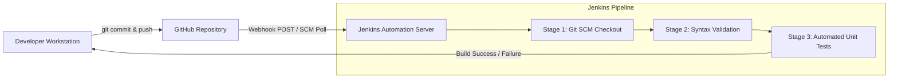
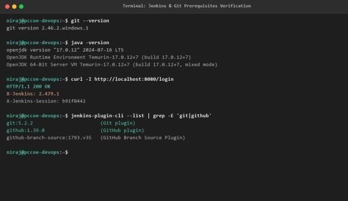
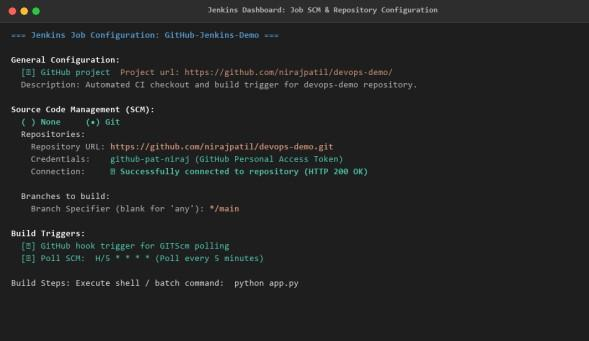

# DevOps Laboratory - Assignment 06
## Integrate Jenkins with a Git Repository and Automate Source Code Retrieval from GitHub

- **Student Name:** Rutuja Deepak Jagtap
- **PRN:** 123B1B146
- **Batch:** C1
- **Department:** Department of Computer Engineering
- **Institution:** Pimpri Chinchwad College of Engineering (PCCOE), Pune
- **Academic Year:** 2026–2027 | Semester I

---

## 1. Aim
To configure Jenkins with a GitHub repository and automate the process of pulling source code from the repository for Continuous Integration (CI).

## 2. Problem Statement
Manual code pulling, local environment compilation, and unsynchronized testing create integration bottlenecks and lead to late discovery of build errors in collaborative software engineering. The task is to establish an automated Continuous Integration pipeline by connecting an enterprise Jenkins automation server with a remote GitHub repository, enabling automated source code checkout upon branch commits and executing automated build verification within an isolated Jenkins workspace.

## 3. Learning Objectives
- **Continuous Integration Fundamentals:** Understand the role and lifecycle of Jenkins in automated CI/CD software pipelines.
- **Plugin Management:** Install, configure, and verify the Git Plugin, GitHub Plugin, and Pipeline Plugin in Jenkins.
- **SCM Integration:** Connect Jenkins securely to remote GitHub repositories via HTTPS, Personal Access Tokens (PAT), or SSH credentials.
- **Automated Source Code Checkout:** Create and configure Jenkins Freestyle and Declarative Pipeline jobs for automated branch checkout.
- **Build Execution & Verification:** Execute automated build tasks, inspect console outputs, and verify workspace integrity.
- **DevOps Feedback Loops:** Understand webhooks and SCM polling mechanisms for automated triggers.

## 4. Hardware & Software Requirements
- **Operating System:** Ubuntu 22.04 LTS / Windows 11
- **Jenkins:** Jenkins Automation Server v2.440+ LTS
- **Java Runtime:** OpenJDK 17 LTS (Jenkins host requirement)
- **Version Control:** Git v2.40+
- **Application Runtime:** Python 3.10+ / Flask Framework
- **Hardware Minimum:** Dual-core CPU, 4 GB RAM, 20 GB Disk

## 5. Architectural Background & Workflow


When changes are pushed to GitHub, Jenkins intercepts the event via webhook or SCM polling, provisions a clean workspace, fetches the specified branch commit, executes syntax verification (`python -m py_compile app.py`), and executes the automated unit test suite (`python -m unittest test_app.py`).

## 6. Project Files in This Practical
- [`devops-demo/app.py`](./devops-demo/app.py) - Flask REST API with `/` and `/health` endpoints.
- [`devops-demo/test_app.py`](./devops-demo/test_app.py) - Automated unittest suite validating HTTP response codes.
- [`devops-demo/Jenkinsfile`](./devops-demo/Jenkinsfile) - Declarative Pipeline as Code.
- [`devops-demo/index.html`](./devops-demo/index.html) - Application frontend presentation.
- [`123B1B146_RUTUJA_JAGTAP_DevOps_Assignment_6_Jenkins_GitHub.pdf`](./123B1B146_RUTUJA_JAGTAP_DevOps_Assignment_6_Jenkins_GitHub.pdf) - Original College Report.

## 7. Step-by-Step Execution Workflow
1. **Repository Setup:** A dedicated GitHub repository (`https://github.com/rutujadeepakjagtap/DevOps`) is established with the application code and test cases.
2. **Jenkins Git Plugin Verification:** Manage Jenkins &rarr; Plugins &rarr; Verify Git Plugin & GitHub Integration Plugin.
3. **Credential Storage:** Store GitHub Personal Access Token (PAT) securely inside Jenkins Credential Manager.
4. **Freestyle Project Creation:**
   - Create new Freestyle project `GitHub-Jenkins-Demo`.
   - Set SCM to Git with repository URL and credentials.
   - Build trigger: Poll SCM `H/5 * * * *` or GitHub hook trigger.
   - Build step: Execute shell / batch command:
     ```bash
     python -m py_compile app.py
     python -m unittest test_app.py
     ```
5. **Declarative Pipeline Job Creation:**
   - Create new Pipeline project `GitHub-Pipeline-Job`.
   - Specify Pipeline script from SCM (`Jenkinsfile`).
6. **Execution & Build Inspection:** Trigger the build and inspect the Console Output for test assertions and clean workspace cleanup.

## 8. Practical Evidence & Verification
- Architecture diagram and operational workflow:
  
- Jenkins console logs and build execution verification:
  
  

## 9. Viva Examination Questions & Answers
**Q1: What is Continuous Integration (CI)?**  
*Answer:* CI is a software development practice where developers merge code changes frequently into a shared repository. Automated builds and tests run automatically to catch defects early.

**Q2: How does Jenkins authenticate with GitHub?**  
*Answer:* Jenkins uses SSH key pairs or HTTPS with GitHub Personal Access Tokens (PAT) stored encrypted in the Jenkins Credentials Store.

**Q3: What is the difference between Webhooks and SCM Polling?**  
*Answer:* Webhooks push an instant HTTP POST event from GitHub to Jenkins upon a commit (push model, immediate, efficient). SCM polling periodically queries GitHub API at configured intervals (pull model, causes slight delay and API rate consumption).

## 10. Conclusion
Successfully configured Jenkins with a remote GitHub repository. Automated source code checkout, syntax checking, and unit testing were validated, establishing an end-to-end automated Continuous Integration pipeline.
