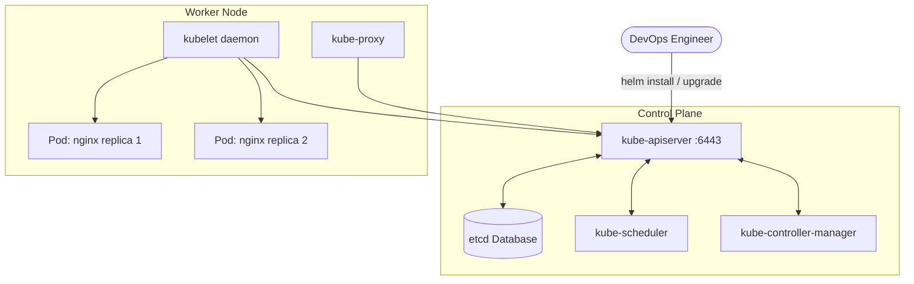
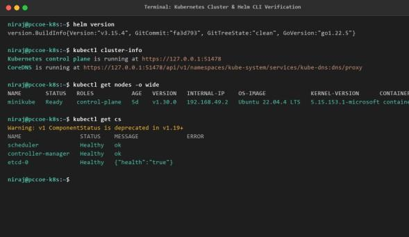
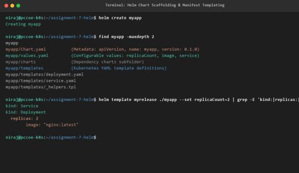

# DevOps Laboratory - Assignment 07
## Explore Kubernetes Container Orchestration and Deploy an Application Using Helm

- **Student Name:** Rutuja Deepak Jagtap
- **PRN:** 123B1B146
- **Batch:** C1
- **Department:** Department of Computer Engineering
- **Institution:** Pimpri Chinchwad College of Engineering (PCCOE), Pune
- **Academic Year:** 2026–2027 | Semester II

---

## 1. Aim
To study Kubernetes architecture and understand the structure and commands of Helm for managing Kubernetes applications.

## 2. Problem Statement
Managing containerized applications across clustered environments using static YAML manifests leads to configuration drift, hardcoded parameters, and complex manual upgrade routines. The task is to examine the distributed architecture of Kubernetes, identify its control-plane and worker-node components, and use Helm as a package manager to scaffold a reusable Helm chart, parameterize deployment templates with `values.yaml`, and perform automated release installation, inspection, rolling upgrades, and clean resource teardown.

## 3. Learning Objectives
- **Container Orchestration:** Understand automated deployment, scaling, networking, service discovery, self-healing, and load balancing.
- **Kubernetes Architecture:** Study distributed master-worker topologies and control-plane vs worker-node architectural roles.
- **Core Components:** Identify responsibilities of API Server, etcd, Scheduler, Controller Manager, kubelet, kube-proxy, and CRI.
- **Helm Package Manager:** Understand Helm charts, values parameterization, templates, dependencies, and release versions.
- **Chart Scaffolding:** Create a structured Helm chart (`myapp/`) with `Chart.yaml`, `values.yaml`, and Kubernetes templates.
- **Release Operations:** Execute `helm version`, `create`, `template`, `install`, `list`, `upgrade`, `status`, and `uninstall` commands with `kubectl` verification.

## 4. Architecture & Topology


## 5. Helm Chart Structure
- [`myapp/Chart.yaml`](./myapp/Chart.yaml) - Metadata package descriptor.
- [`myapp/values.yaml`](./myapp/values.yaml) - Default configurable deployment parameters (replicas, image, service, resource limits).
- [`myapp/templates/deployment.yaml`](./myapp/templates/deployment.yaml) - Parameterized Kubernetes Deployment manifest.
- [`myapp/templates/service.yaml`](./myapp/templates/service.yaml) - Parameterized Kubernetes NodePort Service manifest.
- [`123B1B146_Rutuja_Jagtap_DevOps_Assignment_7_Kubernetes_Helm.pdf`](./123B1B146_Rutuja_Jagtap_DevOps_Assignment_7_Kubernetes_Helm.pdf) - Original College Report.

## 6. Core Helm & Kubectl Commands
```bash
# 1. Scaffolding chart directory
helm create myapp

# 2. Template dry-run validation
helm template my-release ./myapp

# 3. Installing release
helm install my-release ./myapp

# 4. Verifying installed release and pods
helm list
kubectl get pods -l app.kubernetes.io/instance=my-release
kubectl get svc -l app.kubernetes.io/instance=my-release

# 5. Upgrading release (e.g. scale replicas to 3)
helm upgrade my-release ./myapp --set replicaCount=3

# 6. Status and history
helm status my-release
helm history my-release

# 7. Teardown
helm uninstall my-release
```

## 7. Practical Evidence & Verification
- Kubernetes cluster architecture & Helm client interaction:
  
- Execution logs and Helm status verification:
  
  

## 8. Viva Examination Questions & Answers
**Q1: What is Helm and why is it called the package manager for Kubernetes?**  
*Answer:* Helm manages Kubernetes applications similarly to apt/yum on Linux. It packages multiple Kubernetes YAML manifests into a single versioned, parameterized unit called a Helm Chart.

**Q2: What is the purpose of values.yaml in a Helm chart?**  
*Answer:* `values.yaml` provides default variable values that are injected into Go-template manifests in the `templates/` directory during installation or upgrades.

**Q3: What components constitute the Kubernetes Control Plane?**  
*Answer:* `kube-apiserver` (central REST API), `etcd` (consistent key-value state storage), `kube-scheduler` (assigns pods to nodes), and `kube-controller-manager` (runs control loops).

## 9. Conclusion
Successfully explored Kubernetes container orchestration architecture and mastered Helm release lifecycle operations from scaffolding to zero-downtime upgrades and uninstallation.
