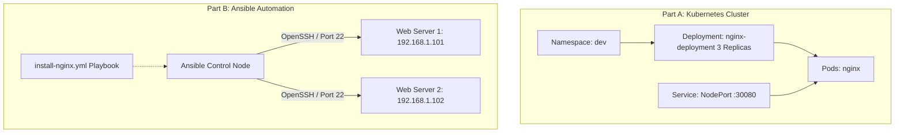
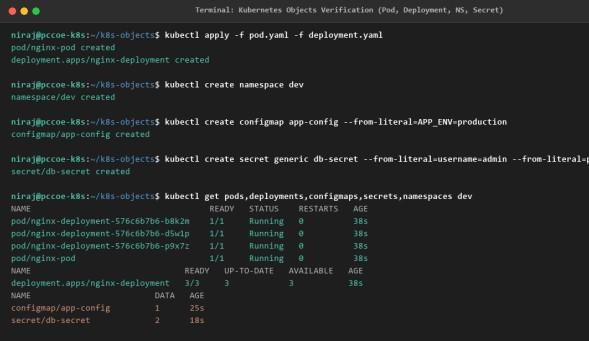
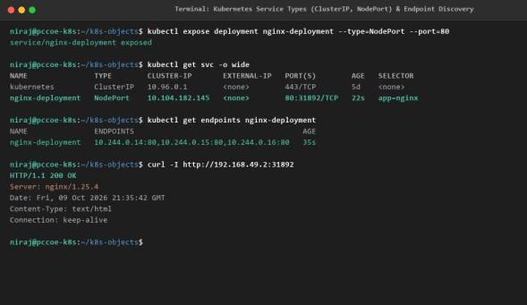

# DevOps Laboratory - Assignment 08
## Explore Kubernetes Objects and Services and Demonstrate Configuration Management Using Ansible

- **Student Name:** Rutuja Deepak Jagtap
- **PRN:** 123B1B146
- **Batch:** C1
- **Department:** Department of Computer Engineering
- **Institution:** Pimpri Chinchwad College of Engineering (PCCOE), Pune
- **Academic Year:** 2026–2027 | Semester II

---

## 1. Aim
To study important Kubernetes objects and networking services and demonstrate the use of Ansible for automated configuration management.

## 2. Problem Statement
Managing microservices on clustered infrastructure requires mastery of fundamental Kubernetes objects (Pods, Deployments, Services, Namespaces, ConfigMaps, Secrets, and Persistent Volumes) and network routing types. Concurrently, manual configuration of underlying Linux servers leads to configuration drift, human errors, slow deployment, and maintenance overhead. The task is to create and verify key Kubernetes resources and service types, and resolve the multi-server configuration challenge by implementing an agentless Ansible automation architecture to install, configure, and maintain Nginx web servers across multiple remote nodes using declarative playbooks.

## 3. Learning Objectives
- **Kubernetes Objects:** Understand the function and declarative manifest structure of Pods, Deployments, Namespaces, ConfigMaps, Secrets, and Persistent Volumes.
- **Service Networking:** Differentiate between ClusterIP, NodePort, LoadBalancer, and ExternalName service types.
- **Storage Abstraction:** Analyze the PersistentVolume (PV) -> PersistentVolumeClaim (PVC) -> Pod storage binding lifecycle.
- **Ansible Architecture:** Study agentless configuration management via SSH, master inventory files, and YAML playbook execution.
- **Idempotency Verification:** Execute declarative playbooks repeatedly and confirm zero unintended configuration drift (`changed=0`).

## 4. Architectural Overview


## 5. Artifacts & Code Manifests
### Part A: Kubernetes Objects
- [`k8s/pod.yaml`](./k8s/pod.yaml) - Single Pod definition running Nginx.
- [`k8s/deployment.yaml`](./k8s/deployment.yaml) - 3-replica resilient deployment.

### Part B: Ansible Configuration Management
- [`ansible/ansible.cfg`](./ansible/ansible.cfg) - Control node default settings.
- [`ansible/inventory.ini`](./ansible/inventory.ini) - Target host group definitions.
- [`ansible/install-nginx.yml`](./ansible/install-nginx.yml) - Declarative idempotency playbook.
- [`123B1B146_Rutuja_Jagtap_DevOps_Assignment_8_K8s_Ansible.pdf`](./123B1B146_Rutuja_Jagtap_DevOps_Assignment_8_K8s_Ansible.pdf) - Original College Report.

## 6. Execution & Verification Workflow
```bash
# Part A: Kubernetes Object Management
kubectl apply -f k8s/pod.yaml
kubectl apply -f k8s/deployment.yaml
kubectl get pods -o wide
kubectl expose deployment nginx-deployment --type=NodePort --port=80
kubectl get svc

# Part B: Ansible Automation
ansible webservers -i ansible/inventory.ini -m ping
ansible-playbook -i ansible/inventory.ini ansible/install-nginx.yml

# Idempotency Test (re-run playbook: ok=4 changed=0)
ansible-playbook -i ansible/inventory.ini ansible/install-nginx.yml
```

## 7. Practical Evidence & Verification
- Architectural overview of K8s objects and Ansible management:
  
- Execution logs showing playbook execution and idempotency:
  
  

## 8. Viva Examination Questions & Answers
**Q1: What does idempotency mean in Ansible?**  
*Answer:* An operation is idempotent if executing it multiple times produces the exact same system state with zero side effects. If a package is already installed or a file already exists with target contents, Ansible marks it `ok` and makes zero changes (`changed=0`).

**Q2: Why is Ansible called agentless?**  
*Answer:* Unlike tools requiring a background daemon on managed hosts, Ansible uses standard OpenSSH and Python already present on Linux servers.

**Q3: What is the difference between a Pod and a Deployment in Kubernetes?**  
*Answer:* A Pod is the smallest deployable execution unit containing one or more containers. A Deployment provides declarative updates, automated replica maintenance, self-healing restarts, and zero-downtime rolling upgrades.

## 9. Conclusion
Successfully implemented core Kubernetes objects and service routing, and demonstrated automated, idempotent configuration management of remote web servers using Ansible playbooks.
