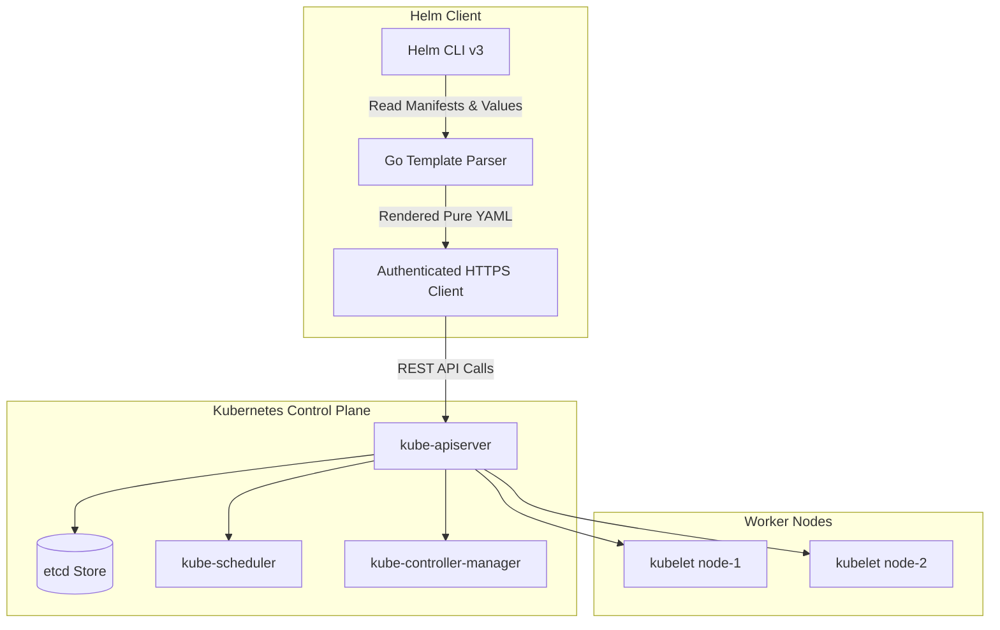
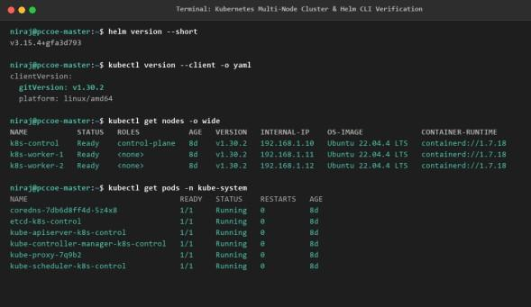
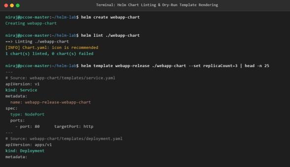

# DevOps Laboratory - Assignment 09
## Explore Container Orchestration using Kubernetes, Architecture, and Helm Chart Management

- **Student Name:** Rutuja Deepak Jagtap
- **PRN:** 123B1B146
- **Batch:** C1
- **Department:** Department of Computer Engineering
- **Institution:** Pimpri Chinchwad College of Engineering (PCCOE), Pune
- **Academic Year:** 2026–2027 | Semester II

---

## 1. Aim
To explore the concept of container orchestration using Kubernetes, evaluate its control-plane and worker-node architecture, and examine the key components of a Helm chart (`Chart.yaml`, `values.yaml`, `templates/`) while performing Helm operations including install, upgrade, uninstall, and template.

## 2. Problem Statement
Deploying and managing microservice topologies on bare container hosts leads to severe configuration drift, manual scaling bottlenecks, lack of self-healing, and unmanageable YAML manifest sprawl. The task is to analyze container orchestration mechanisms in Kubernetes, evaluate its distributed control-plane and worker-node architecture, structure application manifests using a modular Helm chart (`Chart.yaml`, `values.yaml`, `templates/`), and execute full lifecycle release management through Helm commands: `install`, `upgrade`, `template`, and `uninstall`.

## 3. Learning Objectives
- **Container Orchestration Principles:** Understand automated bin-packing, self-healing, horizontal scaling, service discovery, and rolling zero-downtime updates.
- **Kubernetes Architecture:** Study distributed master-worker topologies, control-plane reconciliation loops, and worker-node container execution.
- **Core System Components:** Identify responsibilities of API Server, etcd, Scheduler, Controller Manager, kubelet, kube-proxy, and CRI.
- **Helm Package Management:** Understand Helm v3 client architecture, package versioning, values injection, and release histories.
- **Chart Authoring:** Build a production-ready chart `webapp-chart/` with parameterized deployments and services.
- **Release Lifecycle Operations:** Execute `helm template`, `helm lint`, `helm install`, `helm upgrade`, `helm history`, `helm rollback`, and `helm uninstall`.

## 4. System Architecture


## 5. Helm Chart Directory Structure
- [`webapp-chart/Chart.yaml`](./webapp-chart/Chart.yaml) - Metadata file declaring chart name, version, and appVersion.
- [`webapp-chart/values.yaml`](./webapp-chart/values.yaml) - Parameterized values for image repository, tag, replicaCount, service type, and CPU/memory resources.
- [`webapp-chart/templates/deployment.yaml`](./webapp-chart/templates/deployment.yaml) - Dynamic Deployment template evaluated by Helm.
- [`webapp-chart/templates/service.yaml`](./webapp-chart/templates/service.yaml) - Dynamic Service template exposing the deployment.
- [`123B1B146_RUTUJA_JAGTAP_DevOps_Assignment_9_Kubernetes_Helm.pdf`](./123B1B146_RUTUJA_JAGTAP_DevOps_Assignment_9_Kubernetes_Helm.pdf) - Original College Report.

## 6. Execution & Verification Commands
```bash
# Lint chart for syntax validation
helm lint ./webapp-chart

# Perform template dry-run
helm template webapp-release ./webapp-chart --set replicaCount=3

# Install release
helm install webapp-release ./webapp-chart

# Monitor release status and pods
helm status webapp-release
kubectl get pods -l app.kubernetes.io/instance=webapp-release

# Rolling upgrade
helm upgrade webapp-release ./webapp-chart --set image.tag="1.25.5"

# Release history and rollback
helm history webapp-release
helm rollback webapp-release 1

# Clean uninstallation
helm uninstall webapp-release
```

## 7. Practical Evidence & Verification
- Multi-node Kubernetes architecture and Helm deployment interaction:
  
- Execution logs demonstrating chart rendering and rollback:
  
  

## 8. Viva Examination Questions & Answers
**Q1: How does Helm 3 differ from Helm 2?**  
*Answer:* Helm 3 eliminated Tiller (the in-cluster server daemon), greatly improving security by relying directly on Kubernetes RBAC and storing release states directly inside Secret objects in the release namespace.

**Q2: What is the function of the `helm rollback` command?**  
*Answer:* `helm rollback <release> <revision>` allows restoring a release immediately to any previous recorded revision in case of a failed deployment or application bug.

**Q3: What role does kube-proxy play in worker nodes?**  
*Answer:* `kube-proxy` maintains network routing rules on nodes (via iptables or IPVS) to allow network communication to Pods from inside or outside of the cluster.

## 9. Conclusion
Successfully authored, templated, validated, installed, upgraded, and rolled back a production microservice topology using Helm on a Kubernetes cluster.
