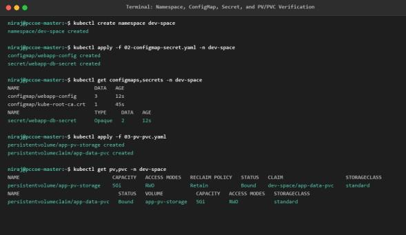
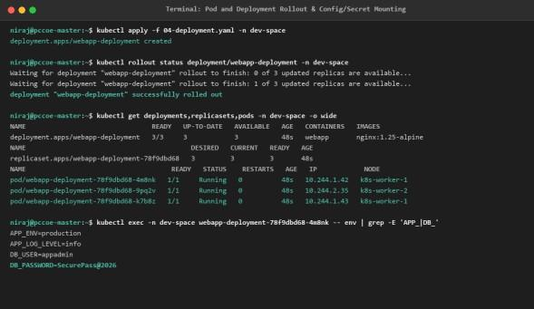

# DevOps Laboratory - Assignment 10
## Discover Kubernetes Objects and Kubernetes Services

- **Student Name:** Rutuja Deepak Jagtap
- **PRN:** 123B1B146
- **Batch:** C1
- **Department:** Department of Computer Engineering
- **Institution:** Pimpri Chinchwad College of Engineering (PCCOE), Pune
- **Academic Year:** 2026–2027 | Semester II

---

## 1. Aim
To explore and implement core Kubernetes objects—including Pods, Deployments, Services, Namespaces, ConfigMaps, Secrets, and Persistent Volumes/Claims—and systematically evaluate Kubernetes service discovery and traffic routing paradigms across ClusterIP, NodePort, LoadBalancer, and ExternalName service types.

## 2. Problem Statement
Cloud-native microservice applications require logical isolation, decoupled configuration, secure secret management, persistent storage, and specialized networking to route internal and external ingress traffic. The practical task is to build a complete application environment inside an isolated namespace (`dev-space`), provision decoupled configs and secrets, attach persistent storage volumes, and expose the workload across all four Kubernetes Service types: ClusterIP, NodePort, LoadBalancer, and ExternalName.

## 3. Learning Objectives
- **Namespace Isolation:** Partition cluster resources into logical tenants using `Namespace`.
- **Decoupled Configurations & Secrets:** Externalize configuration properties using `ConfigMap` and encrypt credentials with `Secret`.
- **Storage Subsystem:** Configure `PersistentVolume` (PV) and bind via `PersistentVolumeClaim` (PVC) into running containers.
- **Service Networking Architecture:** Differentiate between and implement:
  - `ClusterIP`: Default in-cluster virtual IP.
  - `NodePort`: Exposes service on each node's static port (30000–32767).
  - `LoadBalancer`: Provisions cloud provider external load balancer.
  - `ExternalName`: Maps service to external CNAME DNS alias.

## 4. Service Types Comparison Matrix
| Service Type | Scope | Access Port | Typical Use Case |
| :--- | :--- | :--- | :--- |
| **ClusterIP** | In-Cluster only | Internal VIP:80 | Backend APIs, Databases, Internal microservices |
| **NodePort** | External & Internal | NodeIP:30080 | Non-cloud environments, lab testing, direct node access |
| **LoadBalancer**| External & Cloud | Cloud Public IP:80 | Production public ingress on AWS/GCP/Azure |
| **ExternalName**| In-Cluster to External | External DNS CNAME | Mapping internal pod queries to external legacy RDS/APIs |

## 5. Manifest Artifacts
- [`manifests/01-namespace.yaml`](./manifests/01-namespace.yaml) - Logical namespace `dev-space`.
- [`manifests/02-configmap-secret.yaml`](./manifests/02-configmap-secret.yaml) - Decoupled application properties and base64-encoded credentials.
- [`manifests/03-pv-pvc.yaml`](./manifests/03-pv-pvc.yaml) - 5Gi persistent volume and persistent volume claim.
- [`manifests/04-deployment.yaml`](./manifests/04-deployment.yaml) - 3-replica Nginx application consuming ConfigMap, Secret, and PVC volume mount.
- [`manifests/05-services.yaml`](./manifests/05-services.yaml) - All 4 service routing types declared in one file.
- [`123B1B146_Rutuja_Jagtap_DevOps_Assignment_10_K8s_Objects_Services.pdf`](./123B1B146_Rutuja_Jagtap_DevOps_Assignment_10_K8s_Objects_Services.pdf) - Original College Report.

## 6. Execution & Verification Workflow
```bash
# 1. Create isolated namespace
kubectl apply -f manifests/01-namespace.yaml

# 2. Deploy configs and secrets
kubectl apply -f manifests/02-configmap-secret.yaml

# 3. Provision persistent storage
kubectl apply -f manifests/03-pv-pvc.yaml
kubectl get pv,pvc -n dev-space

# 4. Deploy 3-replica workload
kubectl apply -f manifests/04-deployment.yaml
kubectl rollout status deploy/webapp-deployment -n dev-space

# 5. Deploy all 4 Service types
kubectl apply -f manifests/05-services.yaml
kubectl get svc -n dev-space -o wide

# 6. Verify environment variables and mount inside container
kubectl exec -it $(kubectl get pods -n dev-space -l app=webapp -o jsonpath='{.items[0].metadata.name}') -n dev-space -- env
```

## 7. Practical Evidence & Verification
- Architectural topology of objects and service routing:
  
  
- Terminal execution output and service discovery verification:
  
  

## 8. Viva Examination Questions & Answers
**Q1: What is the purpose of an ExternalName service?**  
*Answer:* An `ExternalName` service maps a Kubernetes service name to a DNS CNAME record (e.g. `db.pccoe-cloud.internal`) rather than proxying traffic through kube-proxy or using a cluster IP.

**Q2: How does a PersistentVolumeClaim bind to a PersistentVolume?**  
*Answer:* Kubernetes matches PVC requests (storage capacity, access mode such as `ReadWriteOnce`, and storageClassName) with an available PV and establishes a 1-to-1 persistent binding.

**Q3: What is the valid port range for a NodePort service?**  
*Answer:* By default, Kubernetes allocates NodePorts in the range `30000–32767`.

## 9. Conclusion
Successfully implemented core Kubernetes objects in an isolated namespace and evaluated service networking behavior across ClusterIP, NodePort, LoadBalancer, and ExternalName configurations.
